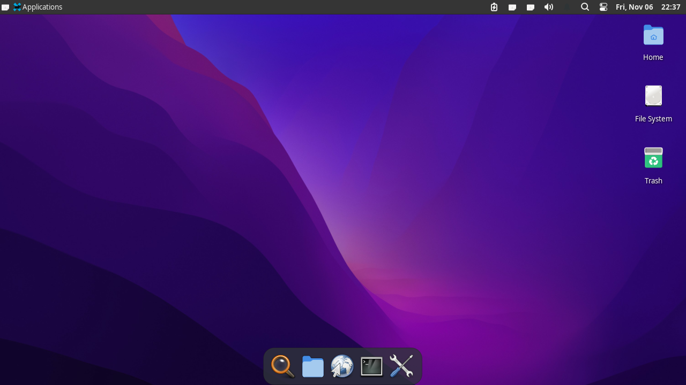

# xfce-apt : depot apt de kits macOS pour XFCE

Paquets : `xfce-macos-1`, `xfce-macos-2`, `xfce-macos-3`. Chacun installe une commande `/usr/bin/xfce-macos-N`
(`info | fetch | install | remove`). Aucun fichier d'original n'est embarque : ils sont telecharges a l'usage.

Depot NON signe (pas de cle GPG), donc `trusted=yes` :

    echo "deb [trusted=yes] https://leo-76.github.io/xfce-apt ./" | sudo tee /etc/apt/sources.list.d/leo.list
    sudo apt update && sudo apt install xfce-macos-1 xfce-macos-2 xfce-macos-3

Teste : construction sur Debian, `apt-get install` / `remove` des 3 paquets depuis une source `file:`.
Teste aussi : `apt update` / `apt install` via HTTPS (Pages) ; rendu sous XFCE 4 (Debian 13, Plank, X11).
Non teste : signature GPG (depot en `trusted=yes`), menu global (le plugin `appmenu` n'existe pas dans Debian 13 : remplace par le menu Applications).

## Rendu

Apres `xfce-macos-1/2/3 install` : fond Monterey, barre du haut, dock Plank a 5 icones (Fichiers, Terminal, Navigateur, Recherche, Reglages).
Plank exige `XDG_SESSION_TYPE=x11` dans l'environnement de session.

